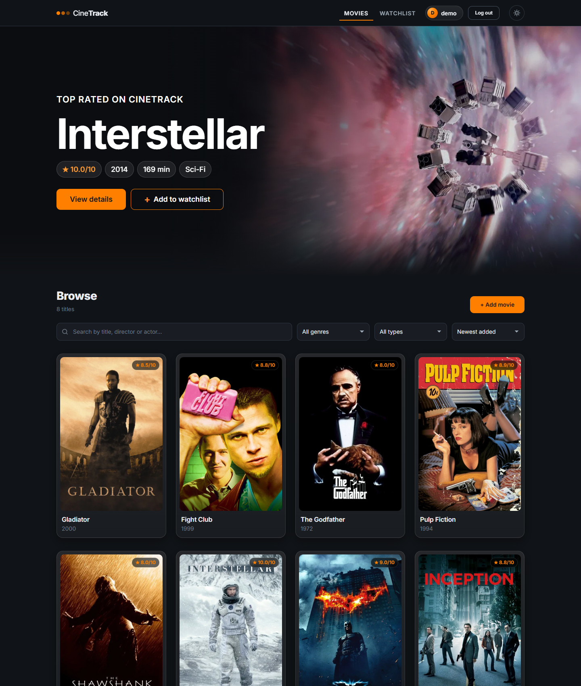
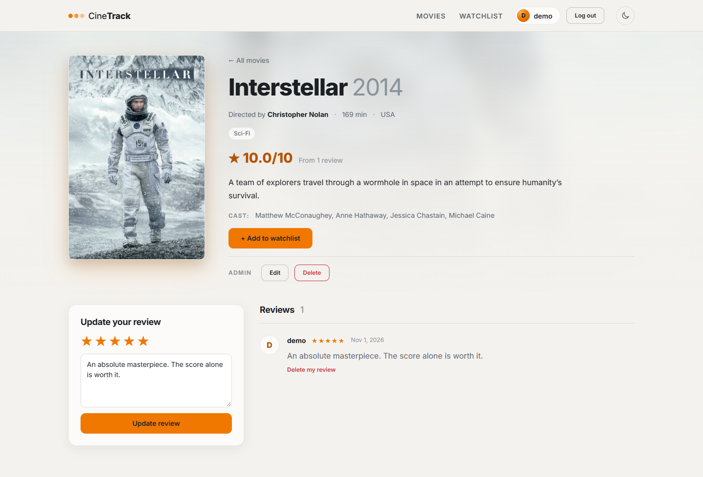
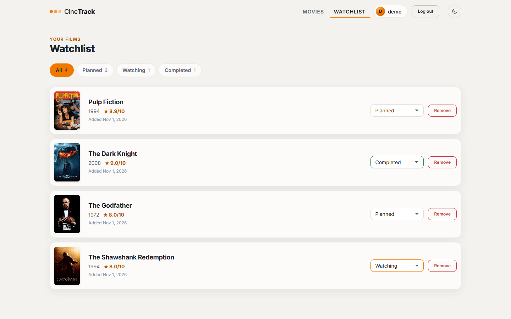
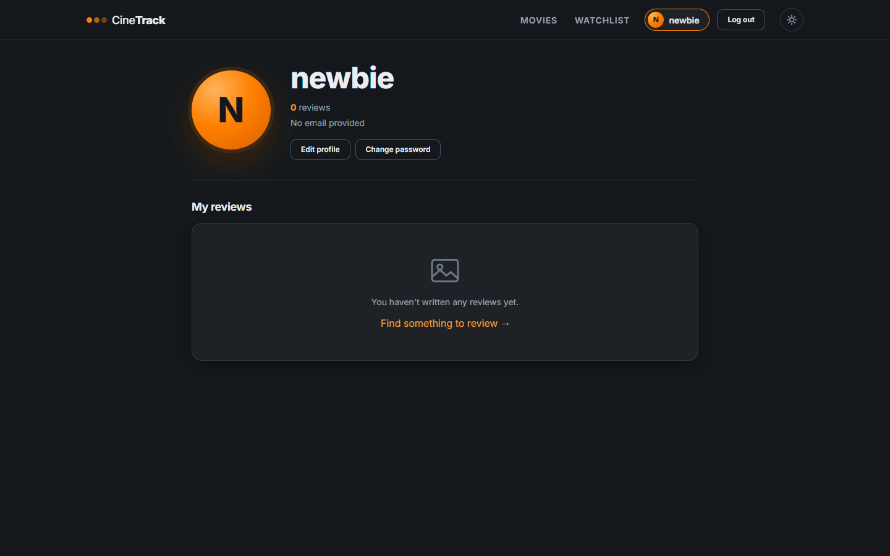
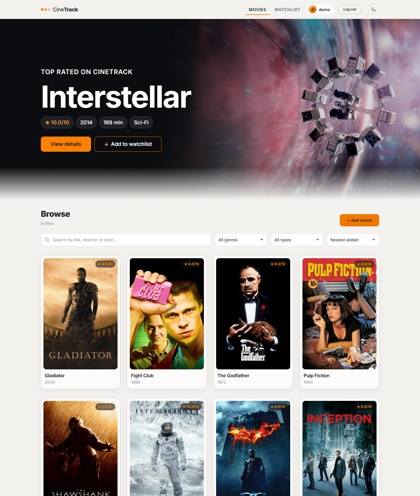
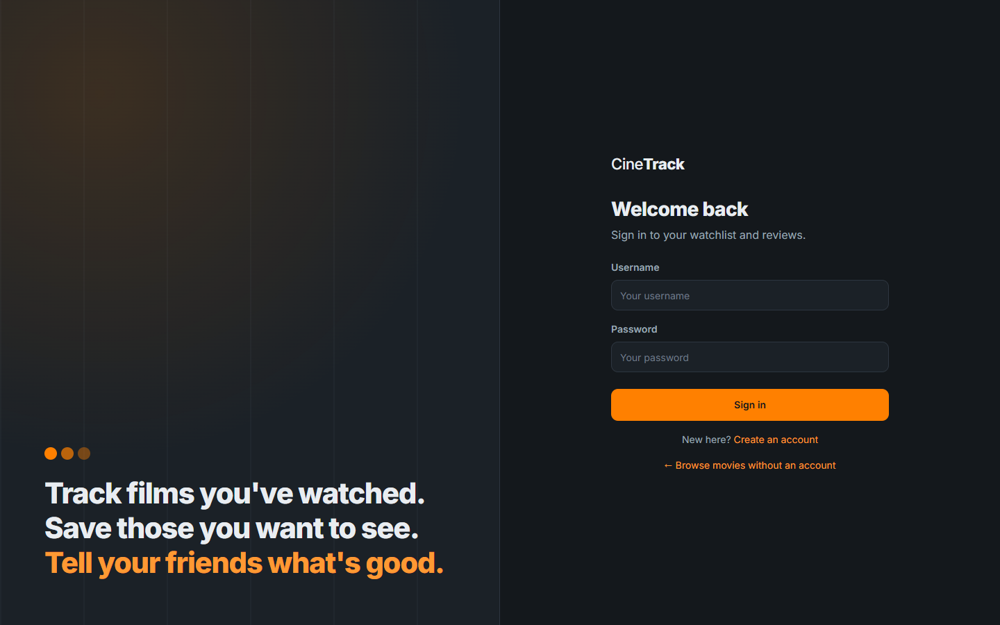
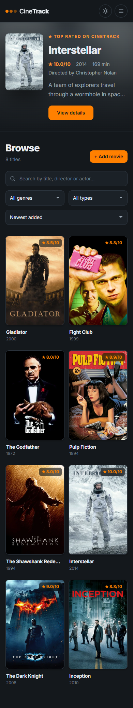
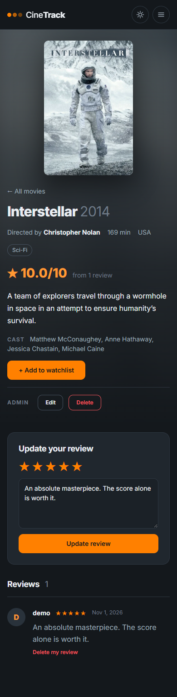

# 🎬 Movie Tracker (CineTrack)

[](https://github.com/Alikhan7RK/Movie-Tracker/actions/workflows/ci.yml)

A full-stack web application for browsing movies, writing reviews and keeping a personal watchlist.
Built for the KBTU Web Development course with **Angular** (frontend) and **Django REST Framework** (backend),
connected through a REST API with **JWT authentication**.

## 👥 Team

* Ryskulov Alikhan
* Assylbek Manarbek
* Kenzhetayev Kaisar

---

## 📸 Screenshots

| Movies (dark) | Movie page (light) |
|---|---|
|  |  |
| **Watchlist (light)** | **Profile** |
|  |  |
| **Movies (light)** | **Sign in** |
|  |  |

<p>
  
  
</p>

---

## ✨ Features

### 🔐 Authentication
* Register, log in and log out (JWT access + refresh tokens; logout blacklists the refresh token)
* The frontend attaches the token to every request with an HTTP **interceptor**
* When the access token expires, the interceptor gets a new one with the refresh token and repeats the request,
  so the user stays logged in. Only if the refresh token is also invalid is the user logged out and sent to the login page
* Route **guards**: `authGuard` (watchlist, profile) and `adminGuard` (add/edit movie pages)

### 🎬 Movies
* Movie list loaded from the API, **12 per page** with page buttons, and a banner with the **top rated** movie
* **Search** by title, director or actor (waits until you stop typing), **genre** and **type** filters
  (Movie / Series / Cartoon / Anime) and **sorting** by rating, year or title. All of it is done by the backend
* Movie page with poster, genres, rating, year, country, director, actors, duration and an embedded **YouTube trailer**
* **Admins** (`is_staff` users) can add, edit and delete movies:
  one shared form for create/edit with validation messages, genre checkboxes and a live poster preview
* Delete asks for confirmation on the page
* **Import from TMDB** (admins): search The Movie Database and import a movie in one click — title, description,
  year, poster, wide backdrop, director, top 5 actors, country, duration, genres and YouTube trailer.
  Importing again updates the movie instead of creating a copy

### ⭐ Reviews and rating
* Anyone can read reviews; logged-in users can write one review per movie (1–5 stars + text)
* Writing again updates your existing review; you can delete your own review
* The movie rating (out of 10) is recalculated automatically: **average stars × 2**.
  If a movie has no reviews, its original rating (`base_rating`) is shown

### 📌 Watchlist
* Add a movie to your watchlist from its page (the page shows the status if it is already added)
* Change status (Planned / Watching / Completed) or remove a movie
* Filter tabs: All / Planned / Watching / Completed

### 🎨 Design
* Cinema-style theme: charcoal background, one orange accent, "glass" cards, metadata pills, large posters,
  Inter font (Google Fonts); a full-width banner with the top rated movie on the movie list
* **Dark / light theme** toggle in the navbar; the choice is saved in `localStorage` (first visit follows the OS setting)
* Fully responsive: phone (menu button), tablet and desktop layouts
* All colors, font sizes, spacing and radius are CSS variables in `frontend/src/styles.css` (the design system);
  components only use `var(--...)`, so the light theme is just a second set of variable values

### 👤 Profile
* Username, email and a list of your reviews
* Edit your username and email; change your password (the current password is required)

---

## ⚙️ Tech Stack

| Part | Technology |
|---|---|
| Frontend | Angular 21 (standalone components, signals, `@if`/`@for` control flow, HttpClient, Router, FormsModule) |
| Backend | Django 6, Django REST Framework, `djangorestframework-simplejwt`, `django-cors-headers` |
| Database | SQLite locally, PostgreSQL in production (`dj-database-url`, `psycopg`) |
| Production | `gunicorn`, `whitenoise`; Render (API) + Neon (database) + Netlify (frontend) |
| CI | GitHub Actions: backend tests, frontend tests, production build on every push |
| Tests | Django `APITestCase` (backend), Vitest (frontend, `ng test`) |

---

## 🚀 Installation & Setup

**Requirements:** Python 3.12+, Node.js 20.19+ (or 22.12+), npm.

### 1. Backend (http://127.0.0.1:8000)

```bash
cd backend
pip install -r requirements.txt
python manage.py migrate            # create the database tables
python manage.py createsuperuser    # admin account (can add/edit/delete movies)
python manage.py seed_movies        # add 4 genres and 8 sample movies (safe to run again)
python manage.py runserver
```

The Django admin panel is available at http://127.0.0.1:8000/admin/.
**API docs (Swagger UI): http://127.0.0.1:8000/api/docs/** — every endpoint with a short description; click
**Authorize** and paste an `access` token to try the protected ones. The raw OpenAPI schema is at `/api/schema/`.

**TMDB import (optional):** get a free key at themoviedb.org → Settings → API, then copy `backend/.env.example`
to `backend/.env` and fill in `TMDB_API_KEY`. `.env` is git-ignored — never commit the key.
Without a key the app works normally; only the "Import from TMDB" page shows an error.

### 2. Frontend (http://localhost:4200)

```bash
cd frontend
npm install
ng serve        # or: npx ng serve
```

Open http://localhost:4200. Log in with the superuser to see the **Add movie**, **Edit** and **Delete** buttons.

The API address comes from `frontend/src/environments/`: `environment.development.ts` (localhost, used by `ng serve`)
and `environment.ts` (the deployed backend, used by `ng build`). Services import it via `src/app/core/api.config.ts`.

### 3. Running the tests

```bash
cd backend
python manage.py test movies        # 89 tests (TMDB is mocked: no network): auth + token refresh, profile editing, movie search/filters/
                                    # sorting/pagination, permissions, reviews + rating, watchlist, seed

cd frontend
ng test --watch=false               # component, interceptor, pipe and helper tests (Vitest)
```

> **Note:** Vitest cannot find test files if the project path contains brackets, e.g. `Movie-Tracker-main (2)`.
> Clone or move the project to a folder without `(` `)` in its path before running `ng test`.

---

## ☁️ Deployment

The app can run for free on **Neon** (PostgreSQL) + **Render** (Django API) + **Netlify** (Angular).
Step-by-step guide for beginners: **[DEPLOY.md](DEPLOY.md)**.

In short: the backend reads its settings from environment variables (`DATABASE_URL`, `SECRET_KEY`,
`CORS_ALLOWED_ORIGINS`, ...). Without them it falls back to the local defaults (SQLite, `DEBUG` on),
so nothing changes for local development. `backend/build.sh` runs `collectstatic`, `migrate`, `seed_movies`
and `create_admin` on every deploy.

---

## 🔗 API Endpoints

📖 **Interactive docs: [`/api/docs/`](http://127.0.0.1:8000/api/docs/)** (Swagger UI, generated by drf-spectacular),
OpenAPI schema at `/api/schema/`.

All endpoints start with `/api/`. Protected endpoints need the header `Authorization: Bearer <access token>`.

**Who can call it:** 🌐 anyone · 🔒 logged-in user · 👑 admin (`is_staff`)

### Auth

| Method | Endpoint | Access | Description |
|---|---|---|---|
| POST | `/api/register/` | 🌐 | Create an account (`username`, `password`, optional `email`) |
| POST | `/api/login/` | 🌐 | Returns `access` and `refresh` tokens |
| POST | `/api/token/refresh/` | 🌐 | Send `refresh`, get a new `access` token (fails after logout) |
| POST | `/api/logout/` | 🔒 | Blacklists the given `refresh` token |
| GET | `/api/profile/` | 🔒 | Current user: `username`, `email`, `is_staff`, `reviews` |
| PATCH | `/api/profile/` | 🔒 | Change your `username` and/or `email`; returns the updated profile |
| POST | `/api/profile/password/` | 🔒 | Change password (`old_password`, `new_password`, min. 4 characters) |

### Movies and genres

| Method | Endpoint | Access | Description |
|---|---|---|---|
| GET | `/api/genres/` | 🌐 | All genres, sorted by name |
| GET | `/api/movies/` | 🌐 | Movies, 12 per page (see the query parameters below) |
| POST | `/api/movies/` | 👑 | Create a movie (`genre_ids` optional) |
| GET | `/api/movies/{id}/` | 🌐 | One movie |
| PUT | `/api/movies/{id}/` | 👑 | Update a movie |
| DELETE | `/api/movies/{id}/` | 👑 | Delete a movie |

Query parameters for `GET /api/movies/` (all optional, can be combined):

| Parameter | Example | Meaning |
|---|---|---|
| `page` | `?page=2` | Page number (12 movies per page) |
| `search` | `?search=nolan` | Title, director or actors contain the text (case-insensitive) |
| `genre` | `?genre=3` | Genre id (from `/api/genres/`) |
| `content_type` | `?content_type=anime` | `movie`, `series`, `cartoon` or `anime` |
| `ordering` | `?ordering=-rating` | `rating`, `year`, `title` or `created_at`; `-` in front = descending. Default `-created_at` (newest added) |

The response looks like `{"count": 17, "total_pages": 2, "next": "...", "previous": null, "results": [...]}`.
Unknown `genre` / `content_type` / `ordering` values return 400, a page that doesn't exist returns 404.

`backdrop_url` (optional) is a wide 16:9 image for the movie list banner and the movie page background;
when it's empty the poster is used instead. `rating` is read-only (calculated by the server). Admins set `base_rating` (0–10). `year` must be between 1888 and the current year + 5.

### Reviews

| Method | Endpoint | Access | Description |
|---|---|---|---|
| GET | `/api/reviews/?movie={id}` | 🌐 | Reviews (optionally only for one movie) |
| POST | `/api/reviews/` | 🔒 | Create a review (`movie`, `text`, `stars` 1–5); updates your existing review for that movie |
| DELETE | `/api/reviews/{id}/` | 🔒 | Delete a review — only its author |

### Watchlist

| Method | Endpoint | Access | Description |
|---|---|---|---|
| GET | `/api/watchlist/` | 🔒 | Your watchlist |
| POST | `/api/watchlist/` | 🔒 | Add a movie (`movie`, optional `status`) |
| PATCH | `/api/watchlist/{id}/` | 🔒 | Change `status` (`planned` / `watching` / `completed`) — only your own items |
| DELETE | `/api/watchlist/{id}/` | 🔒 | Remove an item — only your own items |

### TMDB import

| Method | Endpoint | Access | Description |
|---|---|---|---|
| GET | `/api/tmdb/search/?q={title}` | 👑 | Search The Movie Database (first 20 results; `imported_movie_id` tells if it's already imported) |
| POST | `/api/tmdb/import/` | 👑 | `{"tmdb_id": 157336}` → creates (201) or updates (200) the movie |

Needs `TMDB_API_KEY` on the server (else 503). Movies store their `tmdb_id`, so the same movie is never imported twice.
This product uses the TMDB API but is not endorsed or certified by TMDB.

---

## 📁 Project Structure

```
Movie-Tracker/
├── backend/
│   ├── movie_tracker/          # Django project: settings.py (JWT, CORS), root urls.py
│   ├── movies/                 # main app
│   │   ├── models.py           # Genre, Movie, Review, Watchlist
│   │   ├── serializers.py      # DRF serializers + validation
│   │   ├── views.py            # function views (@api_view) and class views (APIView)
│   │   ├── pagination.py       # MoviePagination (12 per page + total_pages)
│   │   ├── urls.py             # all /api/ routes
│   │   ├── tests.py            # API tests
│   │   ├── migrations/
│   │   └── management/commands/  # seed_movies, create_admin (admin from env vars)
│   ├── build.sh                # Render build: install, collectstatic, migrate, seed, create admin
│   └── requirements.txt
└── frontend/
    ├── public/                 # static files (no-poster.svg placeholder)
    └── src/app/
        ├── core/               # api.config.ts, auth interceptor, authGuard, adminGuard
        ├── features/
        │   ├── auth/           # login, register pages
        │   ├── movies/         # movie-list, movie-detail, movie-form (add/edit)
        │   ├── watchlist/      # watchlist page
        │   └── profile/        # profile page
        ├── models/             # TypeScript interfaces (Movie, Review, WatchlistItem, UserProfile)
        ├── services/           # HttpClient services: auth, movie, review, watchlist; theme (dark/light)
        ├── shared/             # navbar, movie-card, rating pipe, YouTube helper
        └── app.routes.ts       # page routes
```

---

## 📎 Repository

https://github.com/Alikhan7RK/Movie-Tracker
